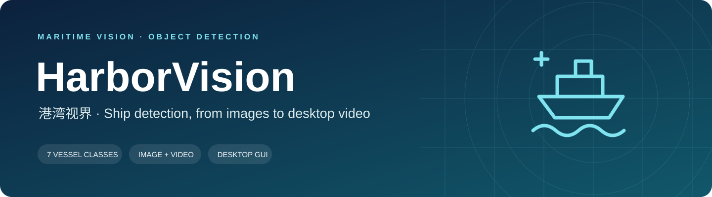
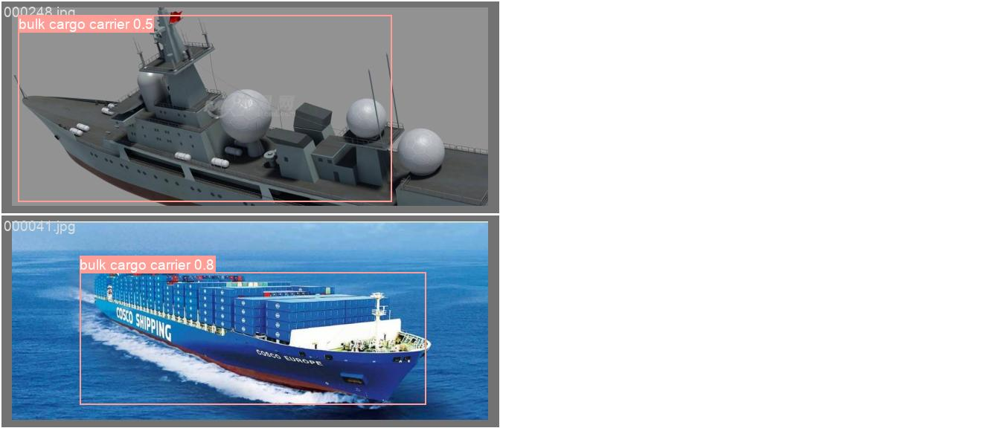
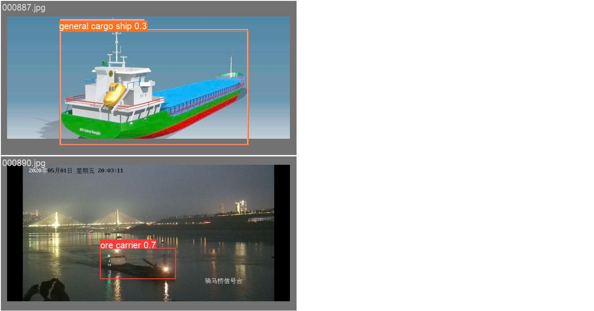
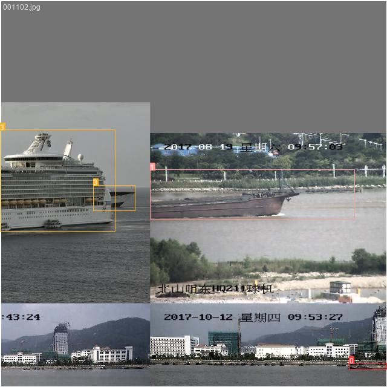
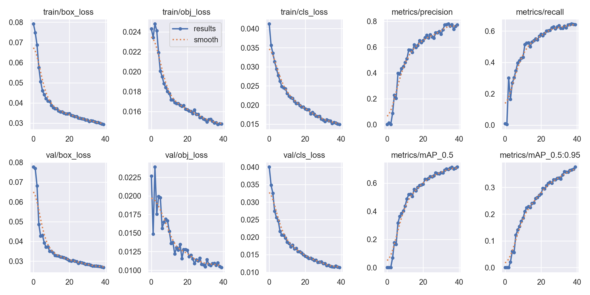
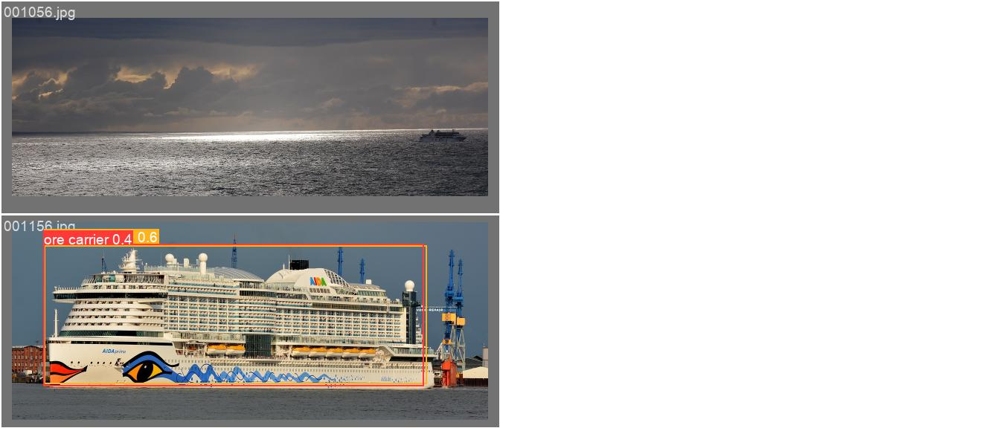
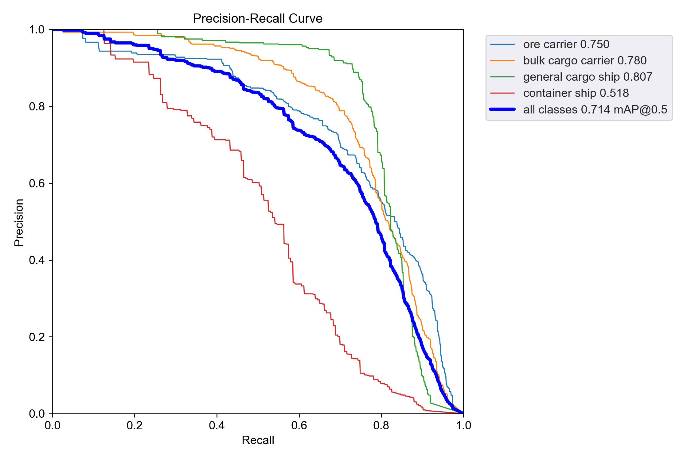
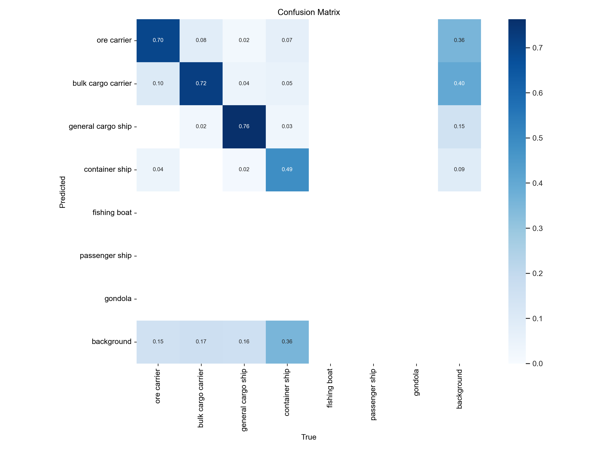

<div align="center">



**港湾视界 · Ship detection, from images to desktop video**

[English](README.md) · [简体中文](README.zh-CN.md)


</div>

---

HarborVision is my ship detection project built with YOLOv5. It locates and classifies seven types of vessels in images and video, with command-line inference and a desktop interface for exploring predictions. The repository includes model configuration, trained weights, evaluation plots, and application source.

## Features

- **Seven vessel classes** — cargo ships, fishing boats, passenger ships, and more.
- **Image and video inference** — bounding boxes, class labels, confidence scores, and optional text output.
- **Desktop interaction** — video and checkpoint selection, confidence/IoU controls, and pause/resume.
- **Training and evaluation** — custom model configuration, 40 epochs of metrics, PR curves, and a confusion matrix.

## Detection gallery

### Model predictions

Saved validation outputs showing bounding boxes, predicted classes, and confidence scores. These examples include classification errors and missed detections.

| Ship examples | Ship and nighttime scene |
| --- | --- |
|  |  |

### Training annotations



A training batch after Mosaic augmentation. The boxes and numeric labels are dataset annotations, not model predictions.

## Results

Validation metrics at the end of the 40-epoch run, from [`results.csv`](runs/train/exp/results.csv), epoch index 39:

| Precision | Recall | mAP@0.5 | mAP@0.5:0.95 |
| ---: | ---: | ---: | ---: |
| 77.34% | 64.17% | 71.39% | 37.65% |



<details>
<summary>View predictions and evaluation plots</summary>



The example also shows remaining missed detections and class confusion. More predictions and ground-truth images are in [`runs/train/exp`](runs/train/exp).




</details>

These are saved validation results from the original training run, not an independent test-set benchmark.

## Quick start

From the project directory, create a dedicated Python environment:

```bash
python -m venv .venv
```

Activate it with `.venv\Scripts\Activate.ps1` in Windows PowerShell, or `source .venv/bin/activate` on Linux/macOS, then:

```bash
python -m pip install -r requirements.txt
python detect.py --weights runs/train/exp/weights/best.pt --data shipdata/ship_parameter.yaml --source path/to/ships.jpg --imgsz 640 --conf-thres 0.25 --device cpu
```

Replace `path/to/ships.jpg` with your own image, image directory, or video path. A video example:

```bash
python detect.py --weights runs/train/exp/weights/best.pt --source path/to/ships.mp4 --imgsz 640 --conf-thres 0.25
```

Results are written under `runs/detect/exp*`. Add `--save-txt --save-conf` to save detections as text. Use `--device 0` with a compatible CUDA-enabled PyTorch installation to select the first GPU.

Dependencies are not fully version-locked. See [compatibility and reproduction notes](docs/REPRODUCIBILITY.md) when setting up a new environment.

### Desktop interface

```bash
python -m pip install -r requirements-gui.txt
python launch_gui.py
```

Select a video to start processing. The app loads the included `best.pt` by default. You can select another checkpoint, adjust confidence/IoU thresholds, and pause or resume processing. Displayed counts refer to detections rather than unique vessels tracked across frames.

## Training

### Prepare the dataset

The dataset is not distributed with this repository. Supply images and matching YOLO annotations using this layout:

```text
shipdata/datasets/
├── images/
│   ├── train/
│   └── valid/
└── labels/
    ├── train/
    └── valid/
```

Each annotation line contains `class_id x_center y_center width height`, with coordinates normalized to 0–1. Class IDs follow [`ship_parameter.yaml`](shipdata/ship_parameter.yaml):

| ID | Class |
| ---: | --- |
| 0 | ore carrier |
| 1 | bulk cargo carrier |
| 2 | general cargo ship |
| 3 | container ship |
| 4 | fishing boat |
| 5 | passenger ship |
| 6 | gondola |

The available local dataset copy is missing validation labels and 15 training images compared with the original record. A complete dataset is needed to reproduce evaluation; see [Reproduction notes](docs/REPRODUCIBILITY.md).

### Train and evaluate

The model uses depth and width multipliers of `0.33` and `0.25`, defined in [`ship_model.yaml`](shipdata/ship_model.yaml). Training settings are saved in [`opt.yaml`](runs/train/exp/opt.yaml).

| Setting | Value |
| --- | --- |
| Epochs / batch size | 40 / 1 |
| Image size | 640 |
| Optimizer / initial learning rate | SGD / 0.01 |
| Data-loader workers / seed | 0 / 0 |
| Initial checkpoint argument | `yolov5s.pt` |

Prepare the initial `yolov5s.pt` checkpoint separately, then run:

```bash
python train.py --weights yolov5s.pt --cfg shipdata/ship_model.yaml --data shipdata/ship_parameter.yaml --hyp runs/train/exp/hyp.yaml --epochs 40 --batch-size 1 --imgsz 640 --workers 0 --optimizer SGD --seed 0 --name harborvision
python val.py --weights runs/train/exp/weights/best.pt --data shipdata/ship_parameter.yaml --imgsz 640 --batch-size 1
```

The custom configuration determines the architecture; the initial checkpoint filename does not imply a standard YOLOv5s network. Only compatible parameter shapes can be transferred.

## Project structure

```text
HarborVision/
├── detect.py              # Image and video inference
├── train.py / val.py      # Training and evaluation
├── launch_gui.py          # Desktop app entry point
├── show_0/                # PyQt5 interface and video processing
├── shipdata/              # Dataset and model configuration
├── models/                # YOLOv5 model implementation
├── utils/                 # Data loading, metrics, and visualization
├── runs/train/exp/        # Checkpoints, metrics, and result plots
└── docs/                  # Reproduction notes and artifact checksums
```

## Author and acknowledgments

Created by [BenjaminW5](https://github.com/BenjaminW5). I developed the ship-detection workflow, including data preparation, model configuration, training, evaluation, and the desktop interface.

Built on [Ultralytics YOLOv5](https://github.com/ultralytics/yolov5). Thanks to the YOLOv5 contributors for the underlying detection framework.

## License

The code retains the [GNU AGPL-3.0 license](LICENSE) and upstream copyright notices. Dataset and third-party media rights remain with their respective owners.
