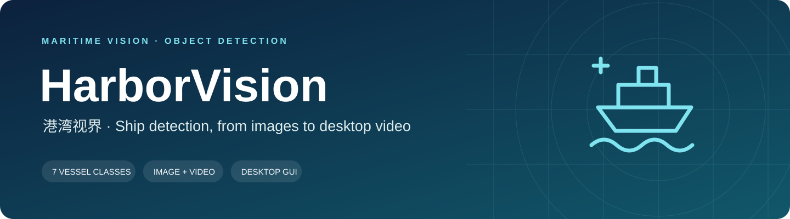
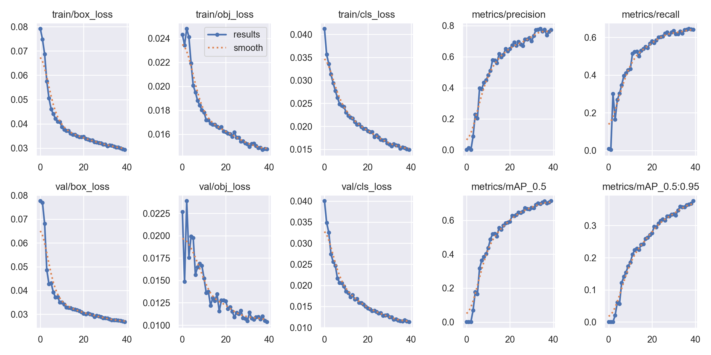

<div align="center">



**港湾视界 · Ship detection, from images to desktop video**

[English](README.md) · [简体中文](README.zh-CN.md)


</div>

---

HarborVision 是我基于 YOLOv5 开发的船只检测项目，可以定位并识别图片和视频中的七类船只。项目提供命令行推理和桌面交互两种使用方式，包含模型配置、训练权重、评估图表和应用源码。

## 功能特点

- **七类船只识别**：覆盖货船、渔船、客船等类别。
- **图片与视频检测**：显示目标框、类别和置信度，可导出文本结果。
- **桌面交互**：选择视频和模型权重，调整置信度与 IoU 阈值，暂停或继续处理。
- **训练与评估**：提供定制模型配置、40 轮训练记录、PR 曲线和混淆矩阵。

## 船只框选展示

### 模型预测

以下是已保存的验证集预测图，展示船只目标框、预测类别和置信度。示例中仍有类别误判和漏检。

| 船只图像检测 | 船只与夜间场景检测 |
| --- | --- |
|  |  |

### 训练标注


上图为经过 Mosaic 数据增强拼接的训练批次，方框和数字类别来自数据集标注，不是模型预测结果。

## 检测效果

以下为 40 轮训练结束时的验证指标，取自 [`results.csv`](runs/train/exp/results.csv) 的最后一行（epoch 索引为 39）：

| Precision 精确率 | Recall 召回率 | mAP@0.5 | mAP@0.5:0.95 |
| ---: | ---: | ---: | ---: |
| 77.34% | 64.17% | 71.39% | 37.65% |



<details>
<summary>查看预测示例与评估图表</summary>


示例中仍存在漏检和类别混淆。更多预测批次及对应标注图可在 [`runs/train/exp`](runs/train/exp) 中查看。


</details>

以上数据来自已保存的训练记录，为验证集结果，不是独立测试集成绩。

## 快速开始

进入项目目录，创建独立的 Python 环境：

```bash
python -m venv .venv
```

Windows PowerShell 使用 `.venv\Scripts\Activate.ps1` 激活环境；Linux/macOS 使用 `source .venv/bin/activate`。然后安装依赖并执行图片推理：

```bash
python -m pip install -r requirements.txt
python detect.py --weights runs/train/exp/weights/best.pt --data shipdata/ship_parameter.yaml --source path/to/ships.jpg --imgsz 640 --conf-thres 0.25 --device cpu
```

将 `path/to/ships.jpg` 替换为自己的图片、图片目录或视频路径。视频推理示例：

```bash
python detect.py --weights runs/train/exp/weights/best.pt --source path/to/ships.mp4 --imgsz 640 --conf-thres 0.25
```

结果保存在 `runs/detect/exp*`。增加 `--save-txt --save-conf` 可输出包含置信度的文本检测结果。安装与 CUDA 匹配的 PyTorch 后，可通过 `--device 0` 指定第一块 GPU。

项目依赖尚未锁定完整版本。配置新环境时，可参考[兼容性与复现说明](docs/REPRODUCIBILITY.md)。

### 桌面视频界面

```bash
python -m pip install -r requirements-gui.txt
python launch_gui.py
```

选择视频后开始处理，默认加载项目内的 `best.pt` 权重。你也可以切换权重、调整阈值，并暂停或继续播放。界面中的数量表示检测目标数，不进行跨帧船只去重跟踪。

## 模型训练

### 准备数据

仓库不附带原始数据集。请准备图片和对应的 YOLO 标注，按以下结构存放：

```text
shipdata/datasets/
├── images/
│   ├── train/
│   └── valid/
└── labels/
    ├── train/
    └── valid/
```

每行标注格式为 `class_id x_center y_center width height`，坐标与尺寸归一化至 0–1。类别编号与 [`ship_parameter.yaml`](shipdata/ship_parameter.yaml) 保持一致：

| ID | 标签 | 类别 |
| ---: | --- | --- |
| 0 | ore carrier | 矿砂船 |
| 1 | bulk cargo carrier | 散货船 |
| 2 | general cargo ship | 杂货船 |
| 3 | container ship | 集装箱船 |
| 4 | fishing boat | 渔船 |
| 5 | passenger ship | 客船 |
| 6 | gondola | 贡多拉船 |

现有本地数据副本缺少验证标签，训练图片也比原始记录少 15 张。复现评估前需要补齐数据，详见[复现说明](docs/REPRODUCIBILITY.md)。

### 训练与验证

模型的深度系数为 `0.33`，宽度系数为 `0.25`，配置见 [`ship_model.yaml`](shipdata/ship_model.yaml)。训练参数保存在 [`opt.yaml`](runs/train/exp/opt.yaml) 中。

| 配置项 | 数值 |
| --- | --- |
| 训练轮数 / 批大小 | 40 / 1 |
| 输入尺寸 | 640 |
| 优化器 / 初始学习率 | SGD / 0.01 |
| 数据加载进程数 / 随机种子 | 0 / 0 |
| 初始权重参数 | `yolov5s.pt` |

另行准备初始化用的 `yolov5s.pt` 权重后，执行：

```bash
python train.py --weights yolov5s.pt --cfg shipdata/ship_model.yaml --data shipdata/ship_parameter.yaml --hyp runs/train/exp/hyp.yaml --epochs 40 --batch-size 1 --imgsz 640 --workers 0 --optimizer SGD --seed 0 --name harborvision
python val.py --weights runs/train/exp/weights/best.pt --data shipdata/ship_parameter.yaml --imgsz 640 --batch-size 1
```

实际网络结构由定制配置决定；初始权重名为 `yolov5s.pt` 不代表使用标准 YOLOv5s 架构，参数迁移需要对应张量形状匹配。

## 项目结构

```text
HarborVision/
├── detect.py              # 图片与视频推理
├── train.py / val.py      # 训练与评估
├── launch_gui.py          # 桌面界面入口
├── show_0/                # PyQt5 界面与视频处理
├── shipdata/              # 数据集与模型配置
├── models/                # YOLOv5 网络实现
├── utils/                 # 数据加载、指标计算与可视化
├── runs/train/exp/        # 模型权重、训练记录与结果图
└── docs/                  # 复现说明与文件校验值
```

## 作者与致谢

作者：[BenjaminW5](https://github.com/BenjaminW5)。我完成了船只检测的数据处理、模型配置、训练评估和桌面界面开发。

项目基于 [Ultralytics YOLOv5](https://github.com/ultralytics/yolov5)，感谢 YOLOv5 贡献者提供的目标检测框架。

## 许可证

代码保留 [GNU AGPL-3.0 许可证](LICENSE)及上游版权声明。数据集与第三方媒体的权利归各自权利人所有。
