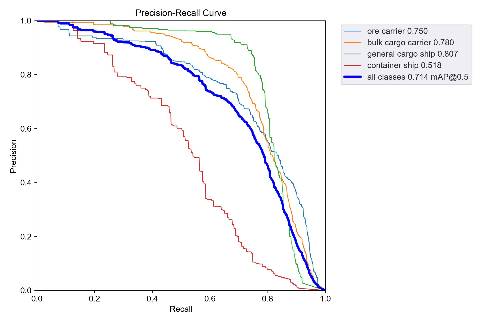
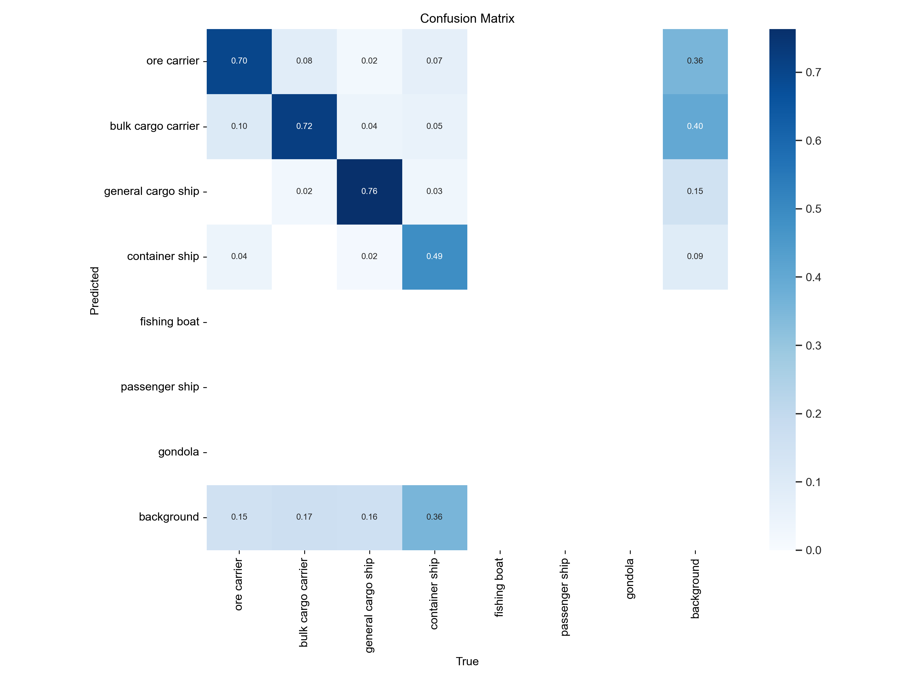
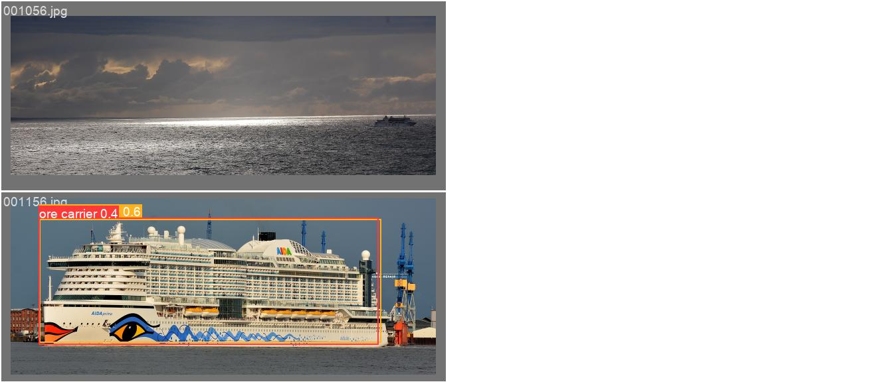

# HarborVision · 港湾视界

**基于 YOLOv5 的七类船只目标检测项目：从模型训练到桌面视频演示。**

[English](README.md) | 简体中文

HarborVision 是一个面向船只图像与视频的个人深度学习项目，包含定制的 YOLOv5 模型配置、训练权重、评估结果，以及 PyQt5 桌面界面。项目名称由 Harbor（港湾）与 Vision（视觉）组成，中文名为“港湾视界”。

项目基于 [Ultralytics YOLOv5](https://github.com/ultralytics/yolov5)，整理并保留项目实现和历史实验结果，不将其描述为原创检测架构或可直接投入航行安全应用的系统。

## 项目特点

- **七类船只识别**：输出目标框、类别与置信度。
- **完整的 40 轮训练记录**：包含 `best.pt`、`last.pt`、CSV 指标及原始结果图。
- **图片与视频推理**：通过 `detect.py` 处理图片、图片目录或视频。
- **PyQt5 视频界面**：支持视频与权重选择、置信度和 IoU 阈值调整、暂停与继续，以及检测数量显示。数量统计不等同于跨帧去重或船只跟踪。
- **中英文说明**：记录实验来源、启动方式和复现条件。

## 个人职责与技术实践

本项目由 **BenjaminW5 独立完成船只检测应用层面的开发与实验**，包括数据整理与标注处理、模型配置、训练调参、评估分析，以及 PyQt5 桌面界面开发；底层检测框架采用 Ultralytics YOLOv5。

| 工作方向 | 实现与项目证据 |
| --- | --- |
| 数据处理 | 七类船只的类别映射、YOLO 标注格式与训练/验证目录配置，见 `shipdata/ship_parameter.yaml` |
| 模型适配 | 配置七类检测头及深度/宽度系数，见 `shipdata/ship_model.yaml` |
| 训练调参 | 使用 SGD、640 输入尺寸、batch size 1 和 workers 0 完成 40 轮训练，保留参数与权重 |
| 评估分析 | 结合 Precision、Recall、两种 mAP、PR 曲线和混淆矩阵分析检测结果 |
| 应用开发 | 基于 PyQt5 与 OpenCV 实现视频展示、权重选择、阈值控制及暂停/继续功能 |

### 技术亮点

- **贯通模型与应用**：将数据配置、训练、评估、命令行推理和桌面交互整合为可查阅的项目流程。
- **面向资源限制配置训练**：使用较小批次和单进程数据加载，降低批次内存需求并简化数据加载；未进行独立的显存或速度对比测试。
- **保留可核查的实验依据**：指标对应原始 CSV，权重和图表附带 SHA-256 校验值，明确现存数据缺失对复现的影响。

### 简历项目描述

> **HarborVision｜基于 YOLOv5 的船只检测与可视化系统**  
> 独立完成七类船只检测项目的数据处理、模型配置、训练调参和评估分析，并使用 PyQt5、OpenCV 开发视频检测界面，支持权重切换、置信度/IoU 阈值调整与播放控制。完成 40 轮训练，历史验证集 mAP@0.5 达到 71.39%，Precision 为 77.34%，Recall 为 64.17%；整理模型权重、评估图表及中英文运行文档。

## 训练结果

以下数值取自 [`runs/train/exp/results.csv`](runs/train/exp/results.csv) 的**最后一行，即第 40 轮（epoch 索引为 39）**。它们是历史训练中的验证指标，并非此次重新测试所得，也不是独立测试集成绩。

| 精确率 Precision | 召回率 Recall | mAP@0.5 | mAP@0.5:0.95 |
| ---: | ---: | ---: | ---: |
| 77.34% | 64.17% | 71.39% | 37.65% |


<details>
<summary>查看 PR 曲线和混淆矩阵</summary>




</details>

### 原始预测示例



这张未经修改的验证图中，远处船只未显示预测框，客船上出现了不同类别的重叠预测。它既展示输出形式，也保留了漏检和类别混淆，不能理解为所有样本都识别正确。更多预测批次及对应标注图见 [`runs/train/exp`](runs/train/exp)。

## 识别类别

类别编号必须与 [`shipdata/ship_parameter.yaml`](shipdata/ship_parameter.yaml) 中的顺序保持一致。

| ID | 英文标签 | 中文说明 |
| ---: | --- | --- |
| 0 | ore carrier | 矿砂船 |
| 1 | bulk cargo carrier | 散货船 |
| 2 | general cargo ship | 杂货船 |
| 3 | container ship | 集装箱船 |
| 4 | fishing boat | 渔船 |
| 5 | passenger ship | 客船 |
| 6 | gondola | 贡多拉船 |

## 快速开始

克隆项目并创建独立的 Python 环境：

```bash
git clone https://github.com/BenjaminW5/HarborVision.git
cd HarborVision
python -m venv .venv
```

Windows PowerShell 使用 `.venv\Scripts\Activate.ps1` 激活环境；Linux/macOS 使用 `source .venv/bin/activate`。然后安装依赖并执行图片推理：

```bash
python -m pip install -r requirements.txt
python detect.py --weights runs/train/exp/weights/best.pt --data shipdata/ship_parameter.yaml --source path/to/ships.jpg --imgsz 640 --conf-thres 0.25 --device cpu
```

将 `path/to/ships.jpg` 替换为自己的图片、图片目录或视频路径。视频推理示例：

```bash
python detect.py --weights runs/train/exp/weights/best.pt --source path/to/ships.mp4 --imgsz 640 --conf-thres 0.25
```

结果保存在 `runs/detect/exp*`。增加 `--save-txt --save-conf` 可输出包含置信度的文本检测结果。安装与 CUDA 匹配的 PyTorch 后，可通过 `--device 0` 指定第一块 GPU。

**环境说明：**原项目没有锁定完整环境，`requirements.txt` 主要声明依赖的最低版本。本仓库保留原始依赖，不代表已验证其与当前所有 Python/PyTorch 版本兼容。代码通过 `torch.load` 加载序列化模型对象；默认仅加载权重的环境可能需要经过检查的兼容性调整，请仅加载可信权重。本次归档整理没有重新执行训练、推理或 GUI 运行测试。

### 桌面视频界面

```bash
python -m pip install -r requirements-gui.txt
python launch_gui.py
```

在界面中选择视频后开始处理；默认模型路径指向仓库内的正式训练权重 `best.pt`。也可以选择其他权重，调整置信度和 IoU 阈值。新增的 `launch_gui.py` 只负责设置原界面所需的工作目录和模块搜索路径，原始界面与推理实现保持不变。

## 训练配置与复现

归档的 [`opt.yaml`](runs/train/exp/opt.yaml) 记录了以下设置：

| 配置项 | 数值 |
| --- | --- |
| 模型配置 | `shipdata/ship_model.yaml` |
| 深度 / 宽度系数 | `0.33` / `0.25` |
| 初始权重参数 | `yolov5s.pt` |
| 训练轮数 / 批大小 / 输入尺寸 | `40` / `1` / `640` |
| 优化器 / 初始学习率 | SGD / `0.01` |
| 数据加载进程数 / 随机种子 | `0` / `0` |

这里实际使用的**定制架构宽度系数为 0.25**。初始权重参数名为 `yolov5s.pt`，但不能仅根据这个文件名将网络描述为标准 YOLOv5s；预训练参数能否迁移取决于张量形状是否匹配。

### 数据集状态

仓库**未包含原始数据集**。现有材料未确认其原始来源和再分发条款，而且当前本地副本不完整：

| 项目 | 项目报告记载 | 本地文件核查 |
| --- | ---: | ---: |
| 训练图片 | 4,678 | 4,663 |
| 验证图片 | 1,157 | 1,157 |
| 训练标签文件 | — | 4,678，其中 15 个没有对应训练图片 |
| 验证标签目录 | — | 缺失 |

项目报告记载总计 5,835 张图片，当前副本实际包含 5,820 张。这两组数字来自不同材料，不能据此确认历史训练时具体使用了哪些文件。**复现指标前需要补齐缺失图片与验证标签，不能将缺失标签当作“图中没有目标”。**

数据采用 YOLO 文本标注格式，每行为 `class_id x_center y_center width height`，坐标和尺寸归一化至 0–1。目录结构如下：

```text
shipdata/datasets/
├── images/
│   ├── train/
│   └── valid/
└── labels/
    ├── train/
    └── valid/
```

准备好完整数据和原始初始权重后，可以参考以下与历史设置对应的训练命令。仓库未附带初始化用的 `yolov5s.pt`，需要另行准备正确的文件；重新训练不保证完全复现原指标。

```bash
python train.py --weights yolov5s.pt --cfg shipdata/ship_model.yaml --data shipdata/ship_parameter.yaml --hyp runs/train/exp/hyp.yaml --epochs 40 --batch-size 1 --imgsz 640 --workers 0 --optimizer SGD --seed 0 --name harborvision
python val.py --weights runs/train/exp/weights/best.pt --data shipdata/ship_parameter.yaml --imgsz 640 --batch-size 1
```

## 项目结构

```text
HarborVision/
├── README.md / README.zh-CN.md
├── detect.py / train.py / val.py / export.py
├── models/                     # YOLOv5 网络实现
├── utils/                      # 数据加载、指标计算、绘图等
├── shipdata/                   # 七类船只数据配置与模型配置
├── show_0/                     # 原始 PyQt 界面和视频推理
├── launch_gui.py               # 适配原界面的启动入口
├── runs/train/exp/             # 正式 40 轮训练结果及两份权重
├── docs/artifact-sha256.json    # 训练产物 SHA-256 校验值
└── docs/upstream/              # 原上游 README，供历史参考
```

正式训练产物来自原项目独立的 `训练结果/exp` 文件夹，**不是**源码目录下的早期试验。本次发布排除了原始数据集、视频、缓存、IDE 配置、无关文件及内部项目报告；原始本地项目保持不变。

## 项目归属与许可证

HarborVision 是 **BenjaminW5 的个人项目**，涵盖船只检测配置、模型训练与评估，以及桌面演示。核心检测框架来自 **Ultralytics 及 YOLOv5 贡献者**，保留原源码声明和项目附带的 [GNU AGPL-3.0 许可证](LICENSE)。上游 README 副本仅供历史参考，其中部分相对链接依赖原来的目录位置。

模型与结果图来自提供的项目归档；它们的收录不意味着底层数据集或第三方媒体另行获得了再分发许可。
